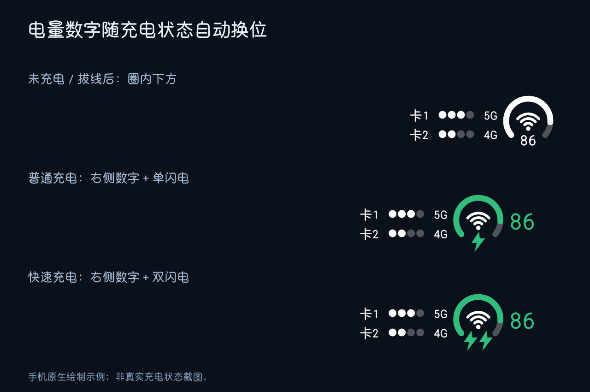
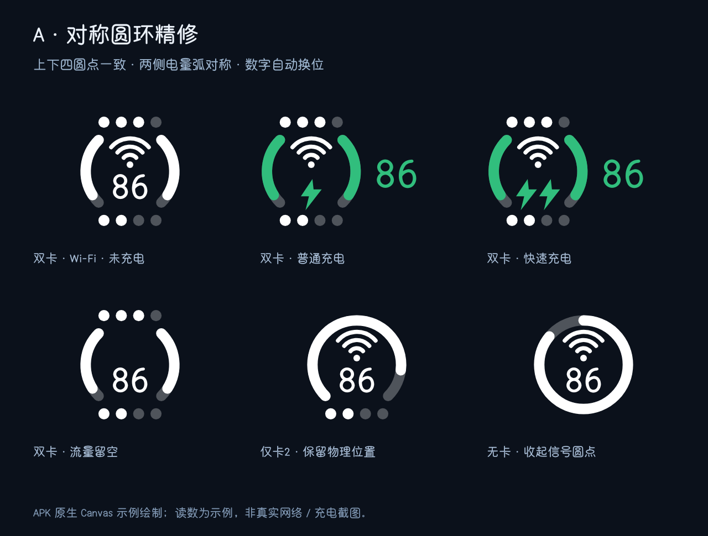

# StatusRing Myron · 环形三合一／双卡

将双卡信号、Wi-Fi 和电量整合显示的 LSPosed 状态栏模块。当前版本 **v1.0.14 测试版**，通过运行时接口检测尝试适配 MIUI / HyperOS，实测设备为 REDMI K90 Pro Max（`myron`）。

[下载 APK](https://github.com/LQB9/StatusRing-Myron/releases) · [更新记录](CHANGELOG.md) · [验证范围](docs/VALIDATION.md)





## 功能

- A 对称圆环、B 圆环＋环外双卡、C 紧凑矩形三种布局，默认 B。
- A 上下两排四圆点使用相同大小、间距，双卡时两侧电量弧镜像对称；圈内 Wi-Fi 与电量分别占位。未插卡的一排隐藏，并闭合对应开口。
- B 布局的两张卡使用相同四圆点样式，标记「卡1／卡2」及各自的网络制式；文字字号与字体跟随原生网速数字，网速控件本身不修改。
- 单卡整行垂直居中，保留物理卡号；无卡时收起左侧卡片区域。Wi-Fi 断开时圆环中心留空。
- 三种布局均支持充电时电量数字移到右侧，普通充电单闪电、系统报告快充时双闪电；拔线后数字回到内部下方。
- 换位使用约 280ms 的轻移与淡入淡出，快速反向切换从当前进度继续。点按设置页预览可演示，不改变实际充电。
- 圈内与右侧电量字号独立调节；右侧默认 46，可调 36–56。B 圈边间距在 28dp 图标高度下约 3.4dp，按字形左边缘对齐。
- 设置即时生效，提供总开关和「重启系统界面」按钮。AOD 保留原生显示；通知／控制中心支持为实验选项，默认关闭。
- 设置页底部包含可点击的本仓库地址。
- 设置页提供「查看兼容检测」，展示 SystemUI 进程实际探测到的宿主、信号、字体和充电岛能力。

## 适配范围

最低安装版本为 Android 12 / API 31，要求支持 libxposed API 102 的框架。**安装门槛不等于实机支持范围。** 当前已核对内部接口并进行真机验证的组合：

| 项目 | 已验证环境 |
| --- | --- |
| 设备 | REDMI K90 Pro Max / `myron` / 25102RKBEC |
| 系统 | HyperOS `OS3.0.308.0.WPMCNXM` / Android 16 / API 36 |
| SystemUI | `16.03.251211.r` |
| 框架 | LSPosed 2.2.1 / libxposed API 102 |

其他 MIUI / HyperOS 机型不再被设备代号拦截；核心电池宿主接口匹配时尝试启用，属于**实验兼容**。ColorOS、One UI、原生 Android 等尚无对应宿主适配器，缺少所需接口时保留原生图标。详见 [兼容策略与矩阵](docs/COMPATIBILITY.md)。

蜂窝、Wi-Fi、网速字体、快充和充电岛分别检测：信号读数或对应视图接口不可用时保留该项原生图标；字体接口缺失时使用默认字体；充电岛保留路径不完整时跟随系统显隐。系统更新后的私有接口仍需重新验证。

## 安装与恢复

1. 从 [Releases](https://github.com/LQB9/StatusRing-Myron/releases) 下载测试版 APK 并安装。
2. 在支持 libxposed API 102 的 LSPosed 中启用模块，作用域只勾选「系统界面（com.android.systemui）」。
3. 首次启用后重启作用域或手机，再打开模块设置。运行后可用设置页的「重启系统界面」按钮。
4. 在模块设置关闭总开关可恢复原生图标；也可在 LSPosed 停用模块后重启作用域。

同一组图标若被其他模块接管，请先关闭对应的重复修改项。

## 本地构建

需要 Python 3、JDK 21 和 Android SDK。已验证的工具链为 build-tools 37.0.0 与 API 37 的 `android.jar`，APK 的 min SDK 为 31、target SDK 为 36。libxposed 102 编译依赖和许可文件位于 `libs/`。

配置 `JAVA_HOME`、`ANDROID_HOME` 后运行：

```text
python build.py
python tests/run_core.py
```

可用 `ANDROID_BUILD_TOOLS_VERSION` 指定 build-tools 版本，`ANDROID_JAR` 指定平台 jar；未指定时从本机 SDK 选择已安装版本。构建输出位于 `build/`。

首次构建会在项目父目录生成 `statusring-signing.jks` 和 `.statusring-sign-password`，后续本地更新需保留它们。仓库不含发布版签名私钥；自行构建的签名与发布版不同，不能直接覆盖发布版安装。请勿提交或上传这些文件。

手机原生绘制检查可在安装后执行：

```text
adb shell am start -n io.github.statusring.myron/.MainActivity --ez selfcheck true
```

这些是应用内示例状态检查，不能代替真实网络、充电与长期运行验证，详见 [验证范围](docs/VALIDATION.md)。

## 参考与依赖

UI 布局思路参考 [HyperDuo](https://github.com/yixing233/HyperDuo)、双卡结构参考 [SignalNumbers 文档](https://github.com/douxian-xzh/SignalNumbers)、系统定制参考 [HyperCeiler](https://github.com/ReChronoRain/HyperCeiler)。用户提供的 ColorOS 模块仅作为外观参考，没有重新分发其代码或资源。

模块实现独立编写；libxposed API／interface／service 的依赖许可见 [THIRD_PARTY_NOTICES.md](THIRD_PARTY_NOTICES.md) 和 `libs/LICENSE-libxposed.txt`。仓库不包含厂商 SystemUI APK、签名私钥、个人手机截图或设备日志。
